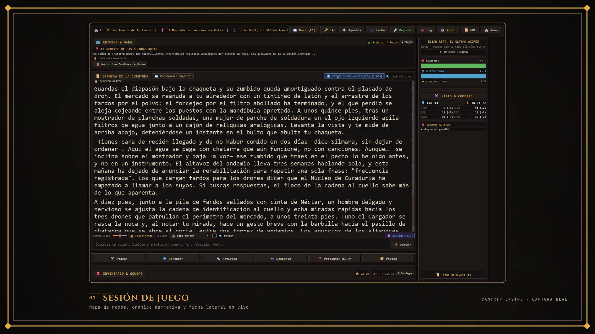
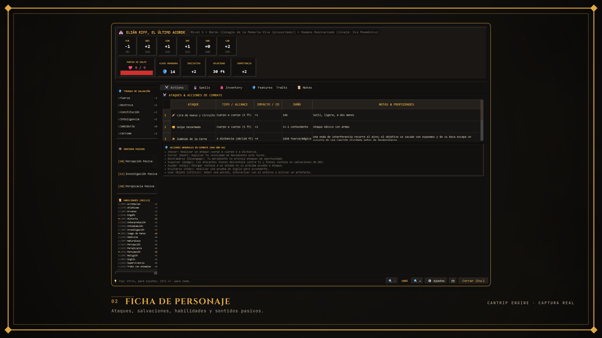

<p align="center">
  
</p>

<p align="center">
  <a href="README.md">Español</a> · <strong>English</strong>
</p>

# Cantrip Engine — Official BYOK Security & Audit Repository

[](https://alecss75.itch.io/cantrip-engine)
[](https://github.com/alecss75/cantrip-engine/releases)
[](LICENSE)
[-green)](https://dnd.wizards.com/resources/systems-reference-document)
[](https://ko-fi.com/alecss75)

Hello! If you are here, you probably saw **Cantrip Engine** on [Itch.io](https://alecss75.itch.io/cantrip-engine) and felt curious — or rightfully cautious — about a desktop application asking for your own API key to play AI-assisted tabletop RPGs.

That skepticism is completely healthy. Too many apps claim to connect to AI while secretly routing requests through unknown proxy servers, storing keys in plain text, or collecting invasive telemetry.

That is why this repository exists. While the full game engine remains proprietary, **we want you to have verifiable proof that your API key stays safe, strictly under your control, and that zero telemetry leaves your machine**.

---

## What Is Cantrip Engine?

**Cantrip Engine** is a native desktop RPG engine for solo **D&D 5e (SRD 5.1)** adventures, available natively in **English and Spanish** (live hot-switch without restarting):

1. **The AI is strictly the narrator (Dungeon Master):** writes atmospheric prose, voices NPCs, and adapts the story to your choices.
2. **Python is the strict rules referee:** every d20 roll, initiative order, Armor Class check, spell slot, 2D ASCII map (*Cartographer's Eye* & active room NPCs), inventory note, and offline character sheet is computed deterministically on your machine. The AI cannot fudge rolls or ignore damage.

The game follows a **BYOK (Bring Your Own Key)** model: connect your own official key from **Google Gemini, Groq, DeepSeek, OpenRouter, or Requesty**. You pay provider rates directly (or use free tiers such as Groq/Gemini), with no monthly subscriptions and no middleman servers.

> **Editions:** **Community Edition** is 100% free and fully playable from start to finish (available here in Releases and on Itch.io). An optional one-time **Supporter Edition** is available on Itch.io with local analytics and cosmetic extras (no gameplay paywalls).

<p align="center">
  
</p>

---

## What Is in This Repository (and Why)?

So you can audit security without exposing proprietary game logic, this public tree publishes the **credentials, networking, and local storage layer**:

* [`src/core/credentials.py`](src/core/credentials.py): **Cryptographic Key Custody.** Stores API keys in your operating system's encrypted native credential store (`Windows Credential Manager` via DPAPI, `macOS Keychain`, or Linux `SecretService`) through `keyring`. Also includes an **Ephemeral RAM-Only Mode** that keeps keys strictly in volatile memory and discards them on exit.
* [`src/llm/gateway.py`](src/llm/gateway.py): **Direct Network Client.** Proves HTTP requests travel directly from your computer to `api.deepseek.com`, `generativelanguage.googleapis.com`, `openrouter.ai`, `api.groq.com`, or `router.requesty.ai`. Enforces a strict host allowlist (`ALLOWED_API_HOSTS`): any unofficial or non-HTTPS endpoint immediately aborts with `PermissionError`.
* [`src/storage/store.py`](src/storage/store.py) & [`src/storage/fs_utils.py`](src/storage/fs_utils.py): **Safe Local Persistence.** Saves campaigns as local JSON files using atomic writes (`os.replace` + `.bak` rotation) inside the OS app-data folder (`%LOCALAPPDATA%` / `Application Support` / `~/.local/share`) or portable mode, never scanning personal documents or uploading saves to the cloud.
* [`tests/test_audit_public.py`](tests/test_audit_public.py): **Automated Isolation Tests.** Executed publicly in GitHub Actions on every update to verify anti-MITM host filtering and automatic secret redaction in logs.

<p align="center">
  
</p>

---

## How to Audit Network Traffic Yourself (in 2 Minutes)

You don't have to take our word for it — verify the compiled binary at runtime:

### 1. With a Local Debugging Proxy (Mitmproxy, Fiddler, Charles)
The app respects standard OS proxy environment variables. With `mitmproxy` listening on port 8080:

```powershell
$env:HTTP_PROXY = "http://127.0.0.1:8080"
$env:HTTPS_PROXY = "http://127.0.0.1:8080"
.\Cantrip-Engine.exe
```

Play a turn and inspect the proxy log: **not a single byte is sent to telemetry or third-party servers**.

### 2. Inspecting Live Connections in PowerShell
```powershell
Get-NetTCPConnection -OwningProcess (Get-Process Cantrip-Engine).Id | Select-Object RemoteAddress, RemotePort, State
```
You will only see outbound HTTPS connections to the official API hosts of the provider you configured.

### 3. Verify Package Integrity (SHA-256)
```powershell
Get-FileHash .\Cantrip-Engine-win64.zip -Algorithm SHA256
```
Match the output against the `SHA256SUMS.txt` published with each [Release](https://github.com/alecss75/cantrip-engine/releases). See [SECURITY.md](SECURITY.md) for details.

---

## License & Legal Terms

The code in this repository is published under a **Source-Available (Read-Only & Audit)** license:
* You are free to download, read, inspect, and run the audit tests on your machine for personal use and security evaluation. Only the networking, credential custody, and storage layers live here — the full game engine cannot be built from this public tree.
* Commercial redistribution, repackaging, resale, or derivative products are strictly prohibited. See [LICENSE](LICENSE) for full legal terms.

Core tabletop rules content is taken from the **System Reference Document 5.1 (SRD 5.1)** by Wizards of the Coast LLC, licensed under Creative Commons Attribution 4.0 International (CC-BY-4.0).

---

## 📬 Security & Contact

If you discover any security vulnerability or credential isolation issue, please report it confidentially via [GitHub Security Advisories](https://github.com/alecss75/cantrip-engine/security/advisories/new) or email `alejandrosansoresarjona@gmail.com`.
