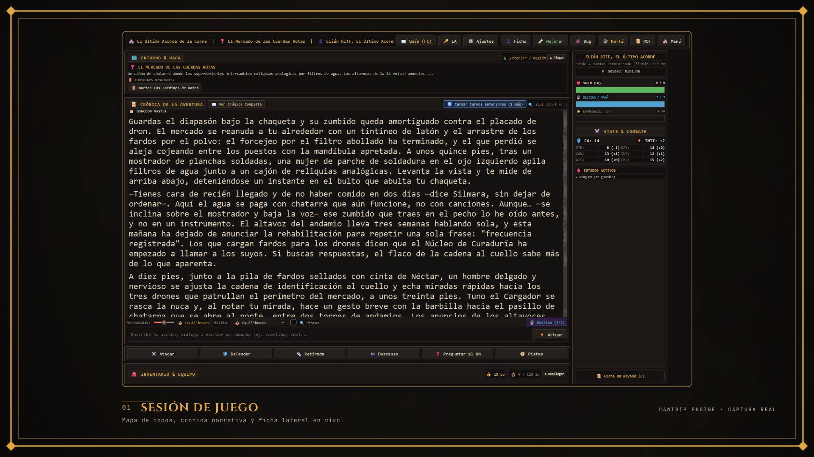
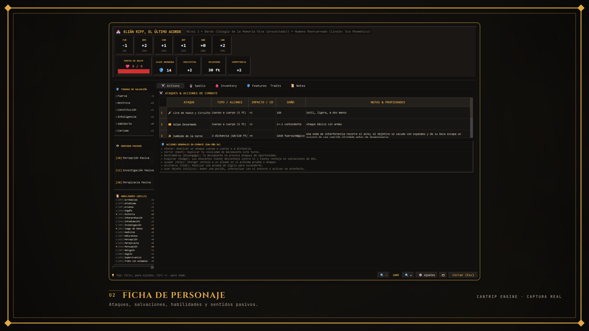

<p align="center">
  
</p>

<p align="center">
  <strong>Español</strong> · <a href="README.en.md">English</a>
</p>

# Cantrip Engine — Repositorio Oficial de Auditoría y Seguridad BYOK

[](https://alecss75.itch.io/cantrip-engine)
[](https://github.com/alecss75/cantrip-engine/releases)
[](LICENSE)
[-green)](https://dnd.wizards.com/resources/systems-reference-document)
[](https://ko-fi.com/alecss75)

Hola. Si estás aquí, probablemente viste **Cantrip Engine** en [Itch.io](https://alecss75.itch.io/cantrip-engine) y te dio curiosidad (o desconfianza) ver una aplicación de escritorio que solicita tu propia API Key para jugar rol con Inteligencia Artificial.

Es una desconfianza totalmente válida y sana. Hoy en día abundan las aplicaciones que prometen conectar con IA pero en realidad desvían peticiones a servidores intermediarios desconocidos, almacenan contraseñas en texto plano o recopilan telemetría abusiva.

Por esa razón existe este repositorio. No pretendemos regalar meses de trabajo en prompts, balanceo y mecánicas de juego, pero **sí queremos que tengas la certeza matemática de que tu clave está a salvo, bajo tu control y de que nadie te está espiando**.

---

## ¿Qué es Cantrip Engine?

**Cantrip Engine** es una aplicación de escritorio para jugar campañas de rol en solitario basadas en **D&D 5e (SRD 5.1)**, disponible completamente en **Español e Inglés** (con cambio en caliente sin reiniciar):

1. **La IA es únicamente el narrador (Dungeon Master):** describe la atmósfera, interpreta a los personajes secundarios y da vida al drama en prosa literaria.
2. **Python es la autoridad estricta de las reglas:** tiradas d20, iniciativa, impactos vs. CA, espacios de conjuro, mapa ASCII 2D con *Ojo del Cartógrafo* y NPCs presentes, notas de inventario y creador manual offline se resuelven de forma determinista en tu computadora. La IA no puede hacer trampas ni ignorar el daño.

El juego opera bajo el paradigma **BYOK (Bring Your Own Key)**: conectas tu propia clave oficial de **Google Gemini, Groq, DeepSeek, OpenRouter o Requesty**. Juegas a precio de coste de proveedor (o usando capas gratuitas como Groq/Gemini), sin suscripciones mensuales ni servidores intermediarios.

> **Ediciones:** La **Community Edition** es 100 % gratuita y jugable de principio a fin (disponible aquí en Releases y en Itch.io). En Itch.io existe opcionalmente una **Supporter Edition** de pago único con extras cosméticos/analíticos locales (sin ventajas jugables ni muros de pago).

<p align="center">
  
</p>

---

## ¿Qué hay en este repositorio y por qué solo estas partes?

Para que puedas auditar la seguridad sin exponer la lógica propietaria del juego, hemos liberado aquí el **núcleo de seguridad, red y almacenamiento**:

* [`src/core/credentials.py`](src/core/credentials.py): **Custodia Criptográfica.** Utiliza el llavero nativo y cifrado de tu sistema operativo (`Windows Credential Manager` vía DPAPI, `macOS Keychain` o `SecretService` en Linux) a través de `keyring`. Incluye un **Modo Solo RAM** que mantiene la clave en memoria volátil y la destruye al cerrar la ventana.
* [`src/llm/gateway.py`](src/llm/gateway.py): **Cliente de Red Directo.** Demuestra que las peticiones HTTP viajan directamente desde tu máquina hacia `api.deepseek.com`, `generativelanguage.googleapis.com`, `openrouter.ai`, `api.groq.com` o `router.requesty.ai`. Posee una lista blanca estricta (`ALLOWED_API_HOSTS`): cualquier dominio no oficial o sin HTTPS se aborta de inmediato con `PermissionError`.
* [`src/storage/store.py`](src/storage/store.py) y [`src/storage/fs_utils.py`](src/storage/fs_utils.py): **Persistencia Local Segura.** Las partidas se guardan en JSON de forma local y atómica (`os.replace` + rotación `.bak`), dentro del directorio de datos del sistema (`%LOCALAPPDATA%` / `Application Support` / `~/.local/share`) o en modo portable, sin escanear tus documentos ni enviar datos a la nube.
* [`tests/test_audit_public.py`](tests/test_audit_public.py): **Pruebas de Aislamiento.** Pruebas automáticas ejecutadas en GitHub Actions en cada cambio, verificando que los filtros contra intermediarios y la redacción de secretos sigan activos.

<p align="center">
  
</p>

---

## Cómo auditar el tráfico tú mismo (en 2 minutos)

No tienes por qué confiar ciegamente en este texto. Puedes comprobar el comportamiento de la aplicación en tiempo de ejecución:

### 1. Con un proxy de depuración (Mitmproxy, Fiddler, Charles)
El juego respeta las variables de entorno de red del sistema operativo. Si ejecutas `mitmproxy` en el puerto 8080:

```powershell
$env:HTTP_PROXY = "http://127.0.0.1:8080"
$env:HTTPS_PROXY = "http://127.0.0.1:8080"
.\Cantrip-Engine.exe
```

Juega un turno y observa el proxy: comprobarás que **no hay un solo byte saliendo hacia servidores de telemetría ni analíticas**.

### 2. Revisando conexiones vivas en PowerShell
```powershell
Get-NetTCPConnection -OwningProcess (Get-Process Cantrip-Engine).Id | Select-Object RemoteAddress, RemotePort, State
```
Solo verás conexiones HTTPS salientes hacia los rangos oficiales del proveedor de IA que hayas configurado.

### 3. Verificar que el ejecutable es auténtico (SHA-256)
```powershell
Get-FileHash .\Cantrip-Engine-win64.zip -Algorithm SHA256
```
El resultado coincide con el valor publicado en `SHA256SUMS.txt` de cada [Release](https://github.com/alecss75/cantrip-engine/releases). Consulta [SECURITY.md](SECURITY.md) para más detalles.

---

## Licencia y Términos

El código en este repositorio está publicado bajo una licencia **Source-Available (Solo Lectura y Auditoría)**:
* Eres libre de descargar, leer, inspeccionar y ejecutar las pruebas de este código en tu máquina para tu uso personal y para evaluar su seguridad. Aquí solo reside la capa de red, credenciales y persistencia: el motor completo del juego no se puede compilar desde este repositorio público.
* Queda estrictamente prohibida la redistribución comercial, reempaquetado, venta o creación de productos derivados a partir de este proyecto. Consulta el archivo [LICENSE](LICENSE) para todos los detalles legales.

El contenido de reglas base de D&D proviene del **System Reference Document 5.1 (SRD 5.1)** de Wizards of the Coast LLC, disponible bajo licencia Creative Commons Attribution 4.0 International (CC-BY-4.0).

---

## 📬 Seguridad y Contacto

Si encuentras cualquier fallo de seguridad o anomalía en el aislamiento de credenciales, puedes reportarlo de forma confidencial mediante [GitHub Security Advisories](https://github.com/alecss75/cantrip-engine/security/advisories/new) o escribir directamente a `alejandrosansoresarjona@gmail.com`.
