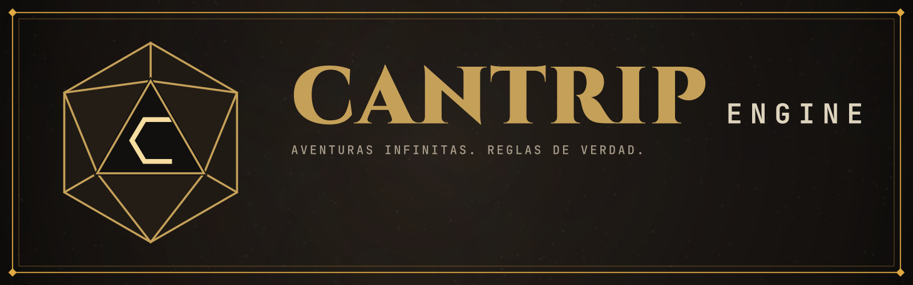
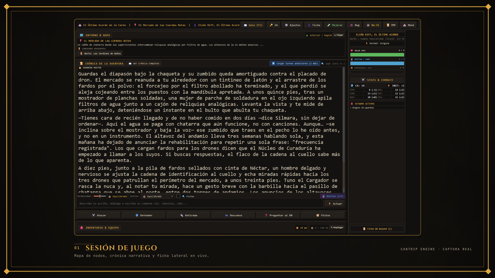
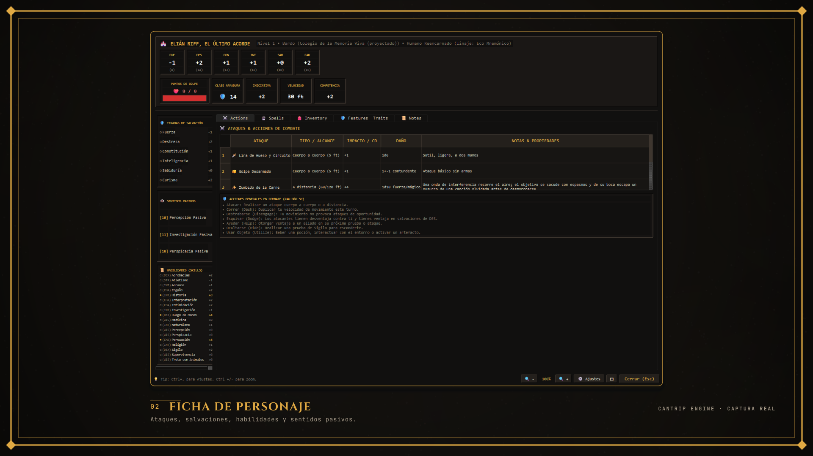

<p align="center">
  
</p>

# Cantrip Engine — Repositorio Oficial de Auditoría y Seguridad BYOK

[](https://alecss75.itch.io/cantrip-engine)
[](https://github.com/alecss75/cantrip-engine/releases)
[](LICENSE)
[-green)](https://dnd.wizards.com/resources/systems-reference-document)
[](https://ko-fi.com/alecss75)

Hola. Si estás aquí, probablemente viste **Cantrip Engine** en [Itch.io](https://alecss75.itch.io/cantrip-engine) y te dio curiosidad (o desconfianza) ver una aplicación de escritorio que solicita tu propia API Key para jugar rol con Inteligencia Artificial.

Es una desconfianza totalmente válida y sana. Hoy en día abundan las aplicaciones que prometen conectar con IA pero en realidad desvían peticiones a servidores intermediarios desconocidos, almacenan contraseñas en texto plano o recopilan telemetría abusiva.

Por esa razón existe este repositorio. No pretendemos regalar meses de trabajo en prompts, balanceo y mecánicas de juego, pero **sí queremos que tengas la certeza matemática de que tu clave está a salvo, bajo tu control y de que nadie te está espiando**.

---

## 🎲 ¿Qué es Cantrip Engine?

La idea de **Cantrip Engine** nació de una frustración común: cuando intentas jugar rol directamente en ChatGPT o Claude, el modelo tiende a inventarse las reglas, alucinar con el daño de las armas y olvidar el contexto a los pocos turnos.

Para resolverlo, el juego implementa una **Arquitectura Híbrida Desacoplada**:
1. **La IA es únicamente el narrador (Dungeon Master):** Describe la atmósfera, interpreta a los personajes secundarios y da vida al drama en prosa literaria.
2. **Python es la autoridad estricta de las reglas:** La matemática de D&D 5e (tiradas d20, iniciativa, impactos vs. CA, espacios de conjuro y durabilidad) la calcula el código de tu computadora de forma determinista bajo el **SRD 5.1**. La IA no puede "hacer trampas" ni ignorar el daño.

El juego opera bajo el paradigma **BYOK (Bring Your Own Key)**: conectas tu propia clave oficial de Google Gemini, Groq, DeepSeek o enrutadores como OpenRouter. Juegas a precio de coste de proveedor, sin suscripciones mensuales infladas.

<p align="center">
  
</p>

---

## 🔒 ¿Qué hay en este repositorio y por qué solo estas partes?

Para que puedas auditar la seguridad sin exponer la lógica propietaria del juego (los orquestadores de prompts y el motor de mecánicas), hemos liberado aquí el **núcleo de seguridad, red y almacenamiento**:

* [`src/core/credentials.py`](src/core/credentials.py): **Custodia Criptográfica.** El juego utiliza el llavero nativo y cifrado de tu sistema operativo (`Windows Credential Manager` vía DPAPI en Windows, `macOS Keychain` o `SecretService` en Linux) a través de `keyring`. Incluye un **Modo Solo RAM** que mantiene la clave en memoria volátil y la destruye por completo al cerrar la ventana.
* [`src/llm/gateway.py`](src/llm/gateway.py): **Cliente de Red Directo.** Demuestra que las peticiones HTTP viajan directamente desde tu máquina hacia `api.deepseek.com`, `generativelanguage.googleapis.com`, `openrouter.ai` o `api.groq.com`. Posee una lista blanca estricta (`ALLOWED_API_HOSTS`): si el juego intentara conectar a un dominio no oficial o sin HTTPS, aborta la petición de inmediato con un `PermissionError`.
* [`src/storage/store.py`](src/storage/store.py) y [`src/storage/fs_utils.py`](src/storage/fs_utils.py): **Persistencia Local Segura.** Las partidas se guardan en formato JSON de forma local y atómica (`os.replace` + rotación `.bak`), dentro de la carpeta del juego o en `%LOCALAPPDATA%`, sin escanear tus documentos personales ni enviar nada a la nube.
* [`tests/test_audit_public.py`](tests/test_audit_public.py): **Pruebas de Aislamiento.** Pruebas automáticas ejecutadas en los servidores públicos de GitHub Actions en cada cambio, verificando que los filtros contra intermediarios y la redacción de contraseñas sigan activos.

<p align="center">
  
</p>

---

## 🕵️‍♂️ Cómo auditar el tráfico tú mismo (en 2 minutos)

No tienes por qué confiar ciegamente en lo que dice este texto. Puedes comprobar el comportamiento de la aplicación en tiempo de ejecución:

### 1. Con un proxy de depuración (Mitmproxy, Fiddler, Charles)
El juego respeta las variables de entorno de red del sistema operativo. Si ejecutas `mitmproxy` en el puerto 8080:

```powershell
$env:HTTP_PROXY = "http://127.0.0.1:8080"
$env:HTTPS_PROXY = "http://127.0.0.1:8080"
.\Cantrip-Engine.exe
```

Juega un turno. Verás en la pantalla del proxy cada petición enviada. Comprobarás que **no hay un solo byte saliendo hacia servidores de telemetría ni analíticas**.

### 2. Revisando conexiones vivas en PowerShell
Si estás jugando y quieres ver con qué servidores está comunicándose el proceso en tiempo real:
```powershell
Get-NetTCPConnection -OwningProcess (Get-Process Cantrip-Engine).Id | Select-Object RemoteAddress, RemotePort, State
```
Solo verás conexiones HTTPS salientes hacia los rangos de IP oficiales de Google, Cloudflare o DeepSeek.

### 3. Verificar que el ejecutable es auténtico (SHA-256)
Si bajaste el binario desde Itch.io o desde los Releases oficiales de GitHub, puedes verificar su integridad calculando el hash:
```powershell
Get-FileHash .\Cantrip-Engine.exe -Algorithm SHA256
```
El resultado coincide con el valor publicado en `SHA256SUMS.txt` de cada [Release](https://github.com/alecss75/cantrip-engine/releases). Consulta [SECURITY.md](SECURITY.md) para más detalles.

---

## ⚖️ Licencia y Términos

El código en este repositorio está publicado bajo una licencia **Source-Available (Solo Lectura y Auditoría)**:
* Eres libre de descargar, leer, inspeccionar y ejecutar las pruebas de este código en tu máquina para tu uso personal y para evaluar su seguridad. Ten en cuenta que aquí solo reside la capa de red, credenciales y persistencia: el motor completo del juego no se puede compilar desde este repositorio público.
* Queda estrictamente prohibida la redistribución comercial, reempaquetado, venta o creación de productos derivados a partir de este proyecto. Consulta el archivo [LICENSE](LICENSE) para todos los detalles legales.

El contenido de reglas base de D&D proviene del **System Reference Document 5.1 (SRD 5.1)** de Wizards of the Coast LLC, disponible bajo licencia Creative Commons Attribution 4.0 International (CC-BY-4.0).

---

## 📬 Seguridad y Contacto

Si encuentras cualquier fallo de seguridad o anomalía en el aislamiento de credenciales, puedes reportarlo de forma cifrada y confidencial a través de [GitHub Security Advisories](https://github.com/alecss75/cantrip-engine/security/advisories/new) o escribirme directamente a `alejandrosansoresarjona@gmail.com`.
